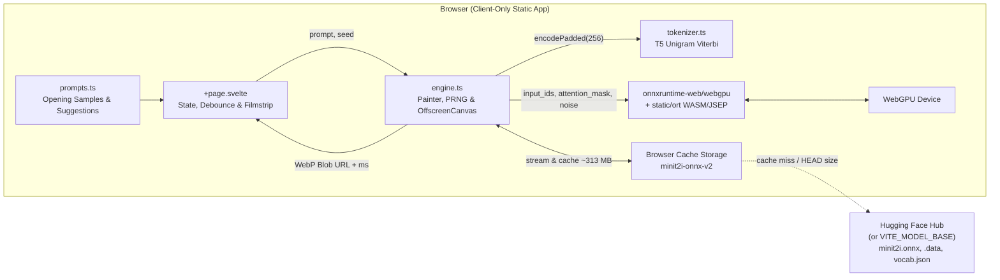
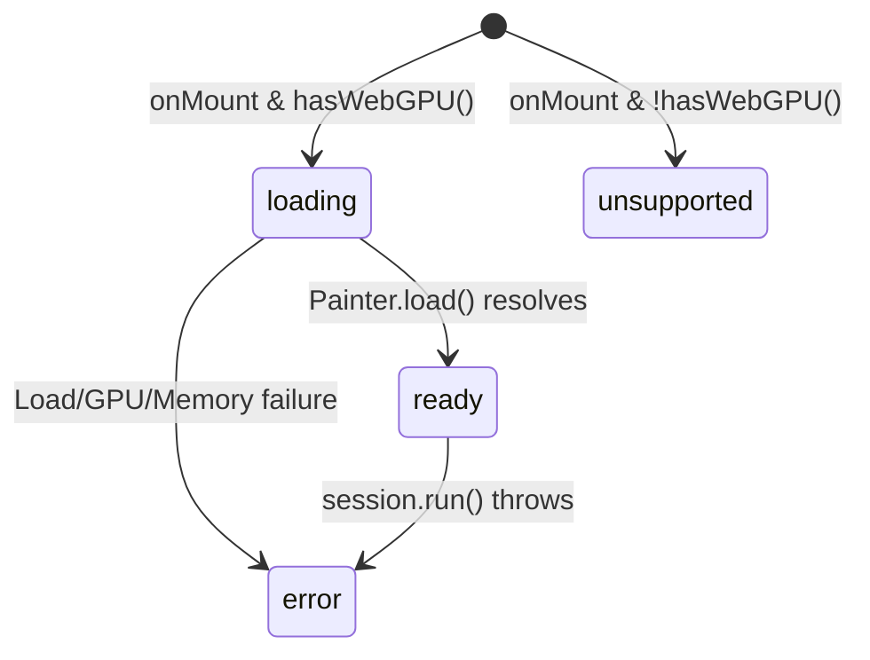

# Architecture

**Imagine** (`minit2i-demo`) is a static, client-side SvelteKit web application that runs text-to-image generation directly in the browser on the user's GPU via **WebGPU** and **ONNX Runtime Web**. Every 512 × 512 image is synthesized locally in 4 steps using the INT8-quantized ONNX export of `MiniT2I-B-16-MF-compact`; no prompts or generated images ever leave the device.

## High-Level System Overview

### Design Principles

- **Zero backend inference**: The app compiles to static HTML/JS/CSS (`@sveltejs/adapter-static`) with hash-based routing so it can be hosted anywhere (e.g., Hugging Face Spaces static SDK or a local static file server).
- **Instant perceived readiness**: Five pre-rendered WebP frames (`static/samples/corgi-0.webp` through `corgi-4.webp`) populate the stage and filmstrip immediately while the ~313 MB model downloads in the background.
- **No cross-origin isolation required**: ONNX Runtime Web is configured with `numThreads = 1` and self-hosted JSEP/WASM assets in `static/ort/`, avoiding `SharedArrayBuffer` and COOP/COEP header requirements on static hosts.
- **Minimal dependencies**: Only `onnxruntime-web` is shipped at runtime. Tokenization, seeded Gaussian noise generation, and image encoding are implemented directly in TypeScript using standard Web APIs.

---

## Repository Layout

| Path | Responsibility |
| --- | --- |
| `src/routes/+page.svelte` | Main single-page UI, reactive state machine, debounced/coalesced paint queue, mirror-overlay prompt editor, filmstrip history, and "About" receipt popover. |
| `src/routes/+layout.svelte` | Minimal root layout injecting the SVG favicon and rendering child routes. |
| `src/lib/engine.ts` | `Painter` class: model download with progress, Cache Storage lifecycle, ONNX Runtime WebGPU session setup, Mulberry32 + Box–Muller noise generation, and CHW-to-WebP conversion. |
| `src/lib/tokenizer.ts` | Standalone SentencePiece-compatible T5 Unigram tokenizer (`T5Tokenizer`) using Viterbi dynamic programming. |
| `src/lib/prompts.ts` | Static prompt datasets: `OPENING` (paired with `static/samples/`), `SUGGESTIONS`, and `SURPRISES`. |
| `src/lib/assets/favicon.svg` | Application favicon imported by `+layout.svelte`. |
| `static/ort/` | Vendored ONNX Runtime Web JSEP/WASM files (`ort-wasm-simd-threaded.jsep.mjs`, `.wasm`). |
| `static/samples/` | Pre-generated WebP outputs from the model (seed 100) representing incremental typing pauses for the opening prompt. |
| `vite.config.ts` | SvelteKit + Vite configuration: Svelte 5 runes enforced for app code, `@sveltejs/adapter-static`, hash router, and `onnxruntime-web` excluded from Vite dep pre-bundling. |
| `index.html` | Root meta-refresh redirect to `build/index.html` for static file servers serving from the repo root. |
| `run.command` / `run.bat` | macOS and Windows convenience launchers that find an open port starting at `8080`, open the browser, and run `http-server`. |

---

## Core Subsystems

### 1. Model Loading & Persistent Caching (`src/lib/engine.ts`)

`Painter.load(modelBase, onProgress)` bootstraps the runtime and fetches three artifacts in parallel from `MODEL_BASE` (defaulting to `https://huggingface.co/cfahlgren1/MiniT2I-B-16-MF-compact-webgpu-int8/resolve/main/`, overridable via `VITE_MODEL_BASE`):

1. `minit2i.onnx` — ONNX computation graph.
2. `minit2i.onnx.data` — External INT8 model weights (~313 MB total across all files).
3. `vocab.json` — T5 Unigram vocabulary table (`[piece, score][]`).

**Download & Cache Strategy:**
- **Size preflight (`cachedSize`)**: Checks Cache Storage `content-length` first; on a cache miss, issues an HTTP `HEAD` request to compute the aggregate total byte count for the progress bar.
- **Streaming reads (`readAll`)**: Reads each `ReadableStream<Uint8Array>` into a dynamically growing `Uint8Array`, reporting per-file byte counts into an aggregate `LoadProgress` callback.
- **Versioned Cache Storage (`openCache`)**: Stores downloaded files under `CACHE_NAME = "minit2i-onnx-v2"`. Before opening the cache, it deletes any older `minit2i-onnx-*` caches (such as the previous 617 MB fp16 `v1` cache) to reclaim disk quota. If Cache Storage is blocked (e.g., private browsing) or writing fails due to quota limits, the app logs a warning and continues without caching.
- **Session initialization**: Configures `ort.env.wasm.wasmPaths` relative to `document.baseURI` (`ort/`), forces `numThreads = 1`, suppresses verbose logs (`logLevel = "error"`), and creates an `ort.InferenceSession` with `executionProviders: ["webgpu"]` and in-memory `externalData` mapped to `"minit2i.onnx.data"`.

### 2. T5 Unigram Tokenizer (`src/lib/tokenizer.ts`)

`T5Tokenizer` implements SentencePiece-compatible Unigram tokenization in ~80 lines of dependency-free TypeScript:

- **Special IDs**: `PAD_ID = 0`, `EOS_ID = 1`, `UNK_ID = 2`; normal pieces begin at ID `3`.
- **Normalization & pre-tokenization**: Applies Unicode `NFKC` normalization, splits on whitespace (`/\s+/`), and prefixes each word with the SentencePiece word-boundary marker `▁`.
- **Viterbi segmentation (`encodeWord`)**: Runs dynamic programming over substrings up to `maxPieceLength` to find the highest-scoring token sequence. Unmatched single characters fall back to `UNK_ID` with score `minScore - 10`, and consecutive `UNK_ID` tokens are collapsed into a single `UNK_ID` to match SentencePiece behavior.
- **Fixed-length tensor encoding (`encodePadded`)**: Appends `EOS_ID`, truncates prompts exceeding `PROMPT_LENGTH = 256` (preserving a trailing `EOS_ID`), and returns `BigInt64Array` buffers for `input_ids` (padded with `0n`) and `attention_mask` (`1n` for active tokens, `0n` for padding).

### 3. Inference Pipeline & Tensor Contracts (`src/lib/engine.ts`)

`Painter.paint(prompt, seed)` executes a single end-to-end generation pass:

1. **Tokenization**: `tokenizer.encodePadded(prompt, 256)` produces `input_ids` and `attention_mask`.
2. **Deterministic Noise (`gaussianNoise`)**: Uses a seeded **Mulberry32** PRNG (`seed >>> 0`) paired with the **Box–Muller** transform, scaled by `NOISE_SCALE = 2` (matching the model scheduler's `init_noise_sigma`), to fill a `Float32Array` of `3 × 512 × 512` values.
3. **ONNX Execution**: Runs `session.run(feeds)` on WebGPU with:

| Direction | Tensor Name | Dtype | Shape | Notes |
| --- | --- | --- | --- | --- |
| Input | `input_ids` | `int64` | `[1, 256]` | T5 token IDs with trailing `EOS` and `PAD` fill |
| Input | `attention_mask` | `int64` | `[1, 256]` | `1` for valid tokens, `0` for padding |
| Input | `noise` | `float32` | `[1, 3, 512, 512]` | Gaussian noise (`σ = 2`) from deterministic seed |
| Output | `image` | `float32` | `[1, 3, 512, 512]` | Planar CHW RGB values in `[-1, 1]` |

4. **GPU Memory Cleanup**: Extracts `image.data as Float32Array` and immediately calls `image.dispose()` to release the ONNX Runtime tensor.
5. **Post-processing (`toObjectUrl`)**: Clamps each CHW pixel to `[-1, 1]`, maps to `[0, 255]` (`clamp(v, -1, 1) * 127.5 + 128`), interleaves into RGBA `ImageData` on a 512 × 512 `OffscreenCanvas`, encodes to `image/webp` (quality `0.92`), and returns `{ url: URL.createObjectURL(blob), ms }`.

### 4. UI State Machine & Request Coalescing (`src/routes/+page.svelte`)

The UI is built with Svelte 5 runes (`$state`, `$derived`) and manages four key concerns:

#### Lifecycle States

- `describeError` classifies runtime exceptions into user-facing messages for WebGPU initialization failures, memory/quota exhaustion, or generic load errors.
- Once `status` transitions to `ready`, the app immediately invokes `request()` to repaint the final opening prompt locally on the user's GPU.

#### Latest-Wins Inference Queue (`request` / `drain`)
Because WebGPU inference takes ~0.5 s and users type continuously, `+page.svelte` avoids unbounded job queues and overlapping GPU calls:
- **Typing debounce**: `onInput()` resets a `600 ms` (`PAUSE_MS`) timer before calling `request()`.
- **Deduplication**: `request()` computes `key = "${seed}:${text}"` and exits early if it matches `lastAsked`.
- **Single pending slot**: Instead of an array queue, `wanted` holds at most one `{ prompt, seed }` job. If `drain()` is already running (`painting === true`), newer requests overwrite `wanted`. When the active `painter.paint()` finishes, `drain()` loops and picks up the latest `wanted` job until idle.
- **Fresh start (`Enter`)**: `startOver()` cancels the debounce timer, triggers `request()` for the current text, awaits `draining`, rotates to a new 31-bit `randomSeed()`, and clears the prompt.

#### Mirror-Overlay Prompt Editor
To highlight which words are already reflected in the displayed image versus newly typed words without drifting the text caret:
- `sharedWords(current.prompt, prompt)` computes the longest word-aligned prefix shared between the displayed frame and the current input.
- A `.mirror` `
` renders the shared prefix in dark ink (`.done`) and the un-painted suffix in upright blue (`<em>`, intentionally `font-style: normal` so glyph widths match the input).
- A transparent `<textarea>` sits directly on top (`position: absolute; inset: 0; color: transparent; caret-color: var(--blue)`) with identical typography, padding, and wrapping rules.
- Font size scales across 4 buckets (`xl` < 60, `lg` < 110, `md` < 180, `sm` ≥ 180 chars) via reactive CSS classes.

#### Filmstrip, Crossfade & Blob URL Lifecycle
- **History cap**: Up to `FRAME_LIMIT = 16` frames are kept in `frames`.
- **In-place replacement vs. append**: If the newly painted prompt matches the last frame's prompt (e.g., repainting the opening frame on load), `show()` replaces the last frame in place; otherwise it appends a new frame labeled with `labelFor(prev, next)` (the newly added suffix if extending the prior prompt, or the full prompt otherwise).
- **Crossfade**: The hero `<figure>` keeps the previous image URL in `.behind` underneath a `{#key current.key}` foreground `` animated with an `arrive` blur/scale fade-in (disabled under `prefers-reduced-motion: reduce`).
- **Memory safety**: On every `show()`, any `blob:` URL evicted from `frames` or displaced from `behind` is checked against all currently referenced URLs (`behind`, `current.url`, `frames`) and freed via `URL.revokeObjectURL()`.

---

## Build, Configuration & Deployment

### Environment Variables
- `VITE_MODEL_BASE` *(optional)*: Overrides the base URL from which `minit2i.onnx`, `minit2i.onnx.data`, and `vocab.json` are fetched. Useful for serving model files locally (e.g., from `/static/model/`, which is `.gitignore`d).

### Scripts (`package.json`)
- `npm run dev` — Starts the Vite development server.
- `npm run build` — Produces the static bundle in `build/` via `@sveltejs/adapter-static`.
- `npm run preview` — Serves the production build locally via Vite.
- `npm run check` — Runs `svelte-kit sync` and `svelte-check` with strict TypeScript checking.

### Hosting & Local Execution
- **Hugging Face Spaces**: Configured via YAML frontmatter in `README.md` (`sdk: static`, `app_build_command: npm run build`, `app_file: build/index.html`). Because Spaces serve `index.html` directly, `vite.config.ts` enables `router: { type: 'hash' }`.
- **Local static serving**: `run.command` (macOS) and `run.bat` (Windows) serve the `build/` directory directly on `127.0.0.1` using `http-server` (falling back to `npx --yes http-server`) on the first free port from `8080` upward, with caching disabled (`-c-1`) and browser launch (`-o`) after startup. Serving `build/` directly ensures SvelteKit's root-absolute `/_app/...` paths resolve properly.

### Runtime Requirements & Constraints
- **WebGPU**: Requires a browser/device exposing `navigator.gpu` (e.g., desktop Chrome or Edge).
- **Web APIs**: Relies on `OffscreenCanvas.convertToBlob({ type: "image/webp" })`, `BigInt64Array`, `ReadableStream`, and optionally `CacheStorage` for persistent model caching.
- **External font**: Loads `Instrument Serif` from Google Fonts with `Georgia, "Times New Roman", serif` fallback.
